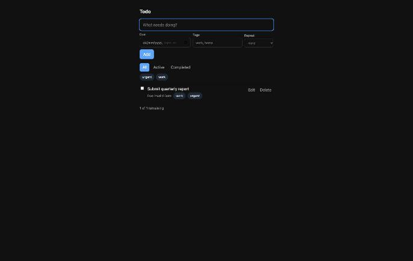
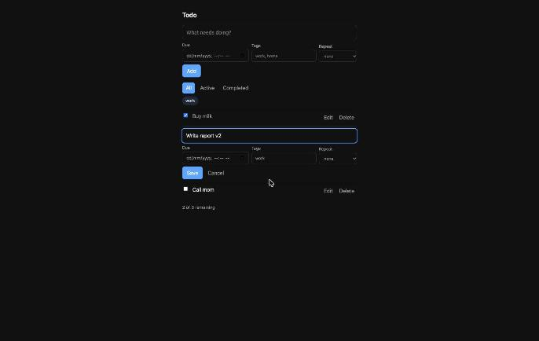
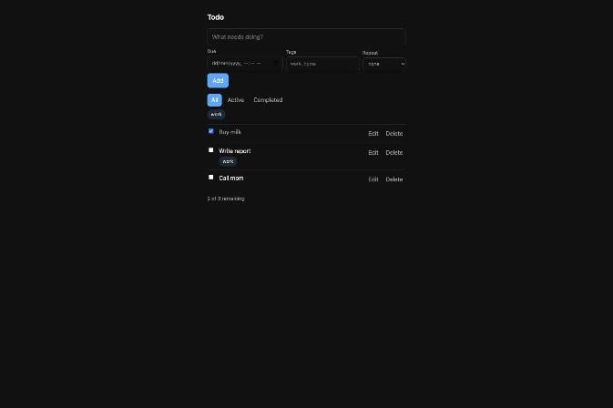
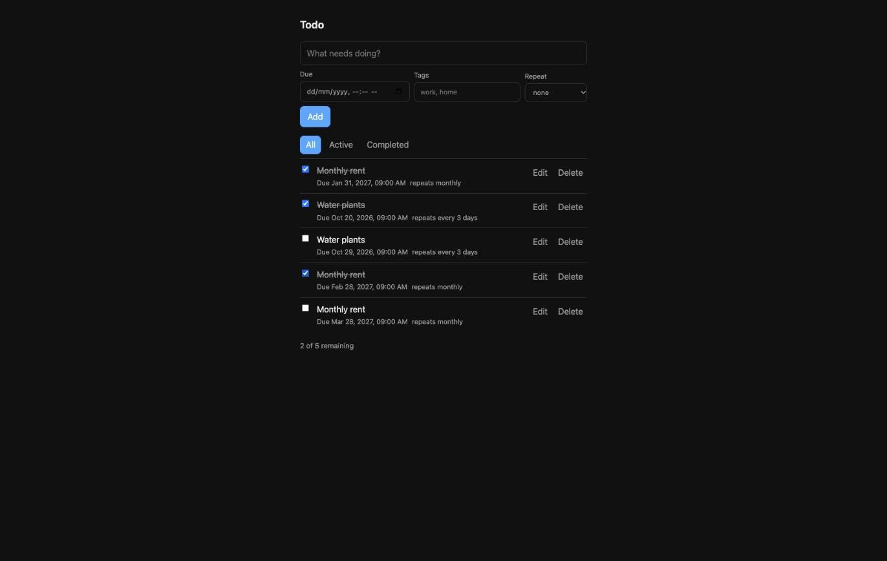
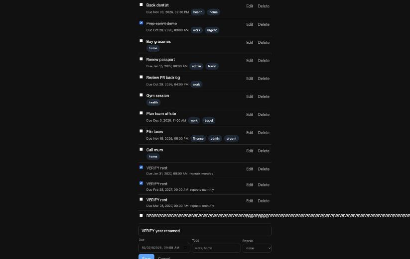

# Persona test: pilot on the todo app (main, 2026-10-27)

5 personas run · 5 completed · 5 issues confirmed by reproduction · 6 unverified lows

Old panel (Power-user Priya, Keyboard Kai, Planner Pat, Newbie Nora, Chaos Cathy); the panel was changed afterwards.

## Friction map

| # | Issue | Personas | Severity | Status |
|---|---|---|---|---|
| 1 | Due-date year accepts 6+ digits, saves, and shows "Due Invalid Date" | ⚡ 🌱 | medium | confirmed |
| 2 | Inline edit: Enter does not save (only the Save button does) | ⚡ ⌨️ | medium | confirmed (no Enter handler in app.js) |
| 3 | Focus drops to the page body after complete, save, delete, tag chip, and Edit | ⌨️ | medium | confirmed |
| 4 | Monthly repeat loses the day after a short month: Jan 31 → Feb 28 → **Mar 28** | 🗓️ | medium | confirmed |
| 5 | A long unbroken title overflows the row and overlaps Edit/Delete; page scrolls sideways | 🌀 | medium | confirmed |
| 6 | Tab from title passes ~6 date segments before Tags; typing early lands in the date, tag silently lost | ⌨️ | low | unverified |
| 7 | Edit draft is discarded when another row is deleted; empty-title Save does nothing silently | 🌀 | low | unverified |
| 8 | Double-click on Add creates a duplicate task | 🌀 | low | unverified |
| 9 | Footer "0 of 1 remaining" is unclear with a finished task on screen | 🌱 | low | unverified |
| 10 | Overdue every-N-days task skips missed dates with no notice | 🗓️ | low | by design (ticket #7: first future occurrence); a notice could be a ticket |
| 11 | List not sorted by due date | ⚡ | — | by design (ticket #6: creation order) |

## Confirmed issues

1. **Invalid year.** Set Due to `82026-02-10T09:00` (the year segment takes extra digits when typed), add. Row shows "Due Invalid Date"; the input has no `max`. 
2. **Enter in edit.** Edit a task, change the title, press Enter: the form stays open. 
3. **Focus loss.** Focus a checkbox, press Space: `document.activeElement` is `BODY`; same after Edit, Save, Delete, tag chip. 
4. **Monthly drift.** Add a monthly task due 31 Jan 2027 09:00, tick it twice: next dues are Feb 28 then Mar 28. Cause: `addInterval` steps from the clamped date instead of the series' original day. 
5. **Long title.** Add a 200-character title with no spaces: the text runs past the row over Edit/Delete; document scroll width 2641 px vs 1680 px viewport. 

## Per persona

| Persona | Completed | Steps | Note |
|---|---|---|---|
| ⚡ Power-user Priya | yes | 24 | Filters, chips and reload fine with 11 tasks; no due sort, no Enter-to-save |
| ⌨️ Keyboard Kai | yes | 30 | Finished everything by keyboard but lost focus after every action |
| 🗓️ Planner Pat | yes | 14 | Month-end drift; daily, weekly and series editing untested |
| 🌱 Newbie Nora | yes | 14 | Added, ticked and found the task; date box fiddly |
| 🌀 Chaos Cathy | yes | 16 | Tags normalise, HTML escaped, no console errors; long word breaks the row |
